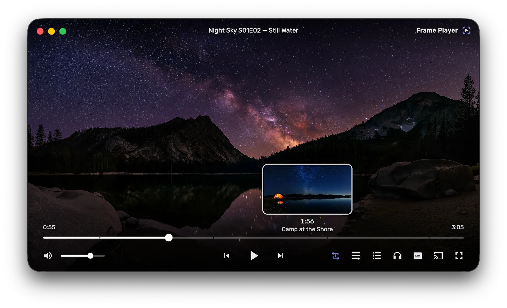

<p align="center">
  
</p>

<h1 align="center">Frame Player</h1>

<p align="center">
  本地文件、链接和磁力种子，一个窗口全都能播，基于 <b>Tauri 2 + libmpv</b>。<br>
  精确到帧，即开即播，对细节格外讲究。
</p>

<p align="center">
  <a href="https://github.com/risenxxx/frame-player/releases/latest"></a>
  
  <a href="LICENSE"></a>
</p>

<p align="center">
  <a href="https://frameplayer.app"><b>官网</b></a> ·
  <a href="https://github.com/risenxxx/frame-player/releases/latest"><b>下载</b></a> ·
  <a href="https://frameplayer.app/updates">更新日志</a>
</p>

<p align="center">
  <a href="README.md">English</a> · <a href="README.ru.md">Русский</a> · <b>简体中文</b>
</p>

<p align="center">
  
</p>

<p align="center">
  <sub>指针悬停在进度条上时，即可预览你将跳转到的那一帧，并显示它所属的章节。</sub>
</p>

解码由 libmpv 完成，与 mpv 和 IINA 是同一个引擎，因此格式支持、硬件加速和 HDR
都无需妥协。mpv 渲染到透明 webview *后方*的一个原生子视图中，整个界面都是叠加在其上的
HTML。正因如此，它才能是一个真正的界面，而不是 OSC 脚本能画出什么就是什么。

## 目录

- [亮点](#亮点)
- [安装](#安装)：[Windows](#windows) · [macOS](#macos)
- [功能](#功能)
- [一起看](#一起看)
- [配置](#配置)
- [快捷键](#快捷键)
- [构建](#构建)：[Windows](#windows-1) · [macOS](#macos-1) · [测试](#测试)
- [项目结构](#项目结构)
- [发布](#发布)
- [许可证](#许可证)

## 亮点

下面的功能大多在别的播放器里也有。不寻常的是，在其他播放器只做到“看起来没问题”的情形下，这里有相当多的地方是*真正正确*的。

**种子边下边播。** 粘贴一个磁力链接，整季内容就会变成一个播放队列，几秒钟内即可开始播放。播放位置附近的文件块会优先下载；进度条会标出已经下载到的部分，跳转之前就能看出是会立即到位还是需要等待；种子里自带的字幕会自动加载；当前一集下载完成后，会提前获取下一集。在你真正要看之前，什么都不会下载，而且**做种默认关闭**。

**和不在身边的人一起看。** 一个六位代码就能让两个播放器共享同一条时间线：同样的位置、同样的暂停、同样的一集。偏差靠微调播放速度来纠正，而不是靠跳转：为了修正十分之一秒而跳转，需要从前一个关键帧开始解码，结果反而比原来偏得更远。只要还有人在缓冲，房间就会自动暂停。如果你看的是种子，其他人会从同一批用户那里下载它，并跟着你一集一集看完整季，无需粘贴任何东西。经过房间服务器的只有时间线，媒体内容从不经过它。

**直接投屏到电视，无需先重新封装。** 播放器支持 Google Cast 和 DLNA，在 Mac 上还可通过系统自带的播放器使用 AirPlay，并按设备、按文件做出选择：只要电视能直接接收原始资源（对 DLNA 渲染器来说，这通常意味着原封不动的 4K HEVC HDR MKV 加杜比音轨），就原样发送，跳转和环绕声都不受影响。做不到时，文件会先重新封装，视频流直接复制，因此一部电影几秒钟就能准备好，而不是一小时。仍在下载的种子也能投屏，与本地播放共用同一条按文件块优先级排序的数据流。播放期间，窗口就是遥控器：播放队列会让投屏在各集之间切换，章节和跳过按钮作用于电视，断开连接时，播放会从当时的位置交回本地。

**跳过片头。** 章节导航、章节列表，以及用于片头、前情提要、“上集回顾”、片尾和广告的跳过按钮。按钮匹配的是完整的章节标题，而不是藏在标题里的某个子串，所以“Ending the war for good”绝不会被当成片尾；跳过提示停留的时间足够你做出反应，又不会在画面上挂整整一分钟。

**字幕本来就是同步的。** 用文件自身的哈希搜索 OpenSubtitles，它能确定你手上的具体资源，而不是去猜你拿到的是哪个压制版本；按片名搜索作为后备。面板会告诉你列表来自这两种方式中的哪一种，因为它们给出的不是同一类答案。下载的字幕保存在视频旁边，下次打开时会自动加载。

**预览显示的就是你将跳转到的那一帧**，而不是它之前的关键帧。在一部 24 分钟的影片上实测，按最直观的方式把指针位置映射到预览，在 60% 的情况下，指针下显示的是另一个场景；而在这里，指针一停下，缩略图就会变成那个位置的精确帧。跳转也经过实测：一次精确跳转在一个文件上耗时 1.9 秒，在另一个文件上耗时 0.05 秒，在大多数文件上则毫无代价。因此播放器会为第一次跳转计时，并依据测量结果做决定，而不是为了保险起见处处牺牲精度。

**从上次停下的地方继续，什么来源都行。** 文件、链接以及种子中的单集都能续播，开始界面会列出未看完的视频及各自的封面帧。你在第 1 集选的配音，到第 2 集会按语言、标题和编解码格式重新找到，绝不按音轨编号，因为编号在不同资源之间会变。

**一个放在哪里就待在哪里的迷你播放器。** 一个始终置顶的小窗口，可以贴边吸附到屏幕四角；在 macOS 上还能浮在其他应用的全屏空间之上，这恰恰是普通置顶窗口做不到的。

界面提供**英语、俄语和简体中文**，每个快捷键都可以重新绑定。

## 安装

两个平台的安装包都会在每次版本号提升时由 CI 构建并发布，请从[最新版本](https://github.com/risenxxx/frame-player/releases/latest)获取：

| 平台 | 文件 | 要求 |
|---|---|---|
| Windows | `FramePlayer_<version>_x64-setup.exe` | Windows 10/11，x64 |
| macOS | `FramePlayer_<version>_aarch64.dmg` | Apple Silicon |

macOS 也可以用一条 `brew install --cask` 安装，见下文 [macOS](#macos)。

macOS 版本使用 Apple Developer ID 签名并经过公证，因此能像其他应用一样直接打开。**Windows 版本未签名**，首次启动时会被 SmartScreen 警告拦下。这关乎的是证书，而不是二进制文件本身：它由[发布工作流](.github/workflows/release.yml)基于本仓库公开构建。更新是另一套机制，在两个平台上都会校验：每个更新包都用项目自己的密钥签名，签名不符的更新包会被播放器拒绝。

安装之后，播放器会自行更新：它在启动时以及之后每六小时检查一次新版本，更新完成后会在原来的位置重新打开当前视频。

### Windows

1. 运行 `FramePlayer_<version>_x64-setup.exe`。SmartScreen 会显示一个蓝色的 **“Windows 已保护你的电脑”** 对话框，上面只有一个*不运行*按钮。
2. 点击 **更多信息**，随即会出现发布者一行，以及一个 **仍要运行** 按钮。
3. 点击该按钮，安装程序即可正常进行。

SmartScreen 看重文件的*信誉*，程度不亚于签名；而新版本就是一个新文件，所以手动安装更新后，还会再次看到这个警告。在播放器内应用的更新不经过 SmartScreen。

### macOS

从[最新版本](https://github.com/risenxxx/frame-player/releases/latest)下载 `FramePlayer_<version>_aarch64.dmg`，打开后把 **Frame Player** 拖到*应用程序*文件夹。

也可以改用 [Homebrew](https://brew.sh)：

```bash
brew install --cask risenxxx/tap/frame-player
```

使用完整限定名时，Homebrew 会顺带添加（tap）这个仓库，所以这一条命令就是全部安装步骤；之后只用 `frame-player` 就能指代这个 cask。

这个 cask 放在[一个单独的 tap](https://github.com/risenxxx/homebrew-tap) 里，而不在 `homebrew-cask` 中，因为后者收录的 cask 必须达到一定的知名度门槛，而本项目还没有达到。它由发布工作流更新版本号，因此新版本发布后一分钟之内，cask 就会指向当前版本。它将播放器声明为可自我更新，这意味着 `brew upgrade` 会刻意不去动它：播放器自己获取经过签名的更新，Homebrew 负责的是安装和卸载，而不是更新渠道。它还声明该构建仅支持 Apple Silicon，因此在 Intel 机器上会拒绝安装并说明原因，而不是装上一个无法运行的应用。

`brew uninstall --cask frame-player` 会移除播放器，但保留播放进度、记住的轨道选择和缩略图缓存；加上 `--zap` 则会一并删除。

你自己从本仓库构建的版本，签名方式与正式发布版不同：没有证书时，它会采用 ad-hoc 签名，这能密封应用包，但不认证任何东西。
于是 macOS 会拒绝首次启动，并在*系统设置 → 隐私与安全性*中提供一个 **仍要打开** 按钮。这条路还有出口；相比之下，未经密封的二进制文件会遭遇*“已损坏”*的拒绝，那条路没有出口。

## 功能

**播放**

- **格式支持与 VLC 相当**：libmpv/FFmpeg 解码，支持硬件加速（Windows 上为 D3D11VA，macOS 上为 VideoToolbox）、10bit、HDR10/HLG/HDR10+ 以及杜比视界 Profile 5/8，通过 `vo=gpu-next` 实现。
- **逐帧** `,` / `.`，前进后退两个方向都不会卡顿。
- **随文件而定的跳转方式**：精确跳转需要从前一个关键帧开始解码，这在大多数文件上不花任何代价，在少数文件上则开销很大；跳转方式按文件探测一次，而不是凭假设决定。
- **进度条缩略图**：悬停预览由一个专用的 FFmpeg 会话解码，后台会生成故事板，重新打开的文件有磁盘缓存，指针停下时还会获取精确帧。
- **章节**，附带章节列表，以及用于片头、前情提要、预告、片尾和广告的跳过按钮。
- **A-B 循环**、三态循环模式（关闭 / 全部 / 单个）、播放速度。
- **播放队列**：由你打开的文件所在的文件夹生成，按自然顺序排列；容器中有标题时，文件名取自容器标题。

**来源**

- **片库**：浏览热门内容或按片名搜索，打开一部电影或剧集，为它挑选资源：画质、动态范围、大小、配音和做种数并排列出，最好的版本排在最前。简介和海报经由项目自己的代理从 TMDB 获取，因此播放器本身不带 API 密钥；资源列表来自你自己的 Torznab 服务器（Jackett、Prowlarr），其地址是一项设置，播放器不内置任何服务器。默认开启，也可以关闭：这是这里唯一会让第三方知道你在*找什么*的功能。
- **链接**：yt-dlp 能解析的任何内容，以及流媒体直链。
- **种子边下边播**：磁力链接会变成一个可播放的队列，由本地回环 HTTP 服务器提供；文件块优先级跟随播放位置，已缓冲的范围显示在进度条上，内嵌字幕自动加载，下一集提前获取。存储空间在播放器内管理，做种默认关闭（这是 librqbit 的一个编译期特性，而不是速率限制）。
- **字幕搜索**（OpenSubtitles）：按文件哈希匹配，按片名搜索作为后备；登录是可选的，仅用于提高每日限额。

**电视**

- **两种传输方式，自动替你选择**：Google Cast 和 DLNA 同时发现，每台设备合并为一行。这一行会说明*这个*文件在*那台*设备上会怎样处理（“直接播放”“播放前需先准备”），也可以为每台设备固定选择。
- **Mac 上的 AirPlay**：在同一菜单中点一行，即可在系统自带的列表里选择 Apple TV 或支持 AirPlay 的电视。电视像其他设备一样直接从播放器获取文件；HEVC 会重新封装，以带上 Apple 播放器要求的标记，窗口仍是同一个遥控器。Windows 版有意不支持：Apple 没有在那里提供实现方式，而自行重建其封闭协议的代价远超它能服务的少数用户。
- **不需要准备时就不准备**：只要渲染器列出了该容器格式，就播放原始文件，HEVC、HDR 和环绕声都得以保留；需要生成副本时，视频流直接复制，只重新编码音频。
- **边下边投**：种子由供本地播放的同一条阻塞式数据流提供给电视，并在开始加载前先缓冲出一段余量。
- **窗口变成遥控器**：播放队列推进投屏会话，进度条和按键控制电视；设备做不到的事（调节它自身的音量、选择它自身的音轨）会用文字说明，而不是让控件毫无反应。
- **设备检查**：一个按钮即可生成一份报告，列出设备的回应：能否连通、接受哪些格式、是否支持跳转、关于音量它怎么说。报告可以复制，而且检查从不会在屏幕上启动任何东西。

**界面**

- **无边框界面**：自定义标题栏、悬浮在视频上、自动隐藏的控制栏、自定义提示框、文字 OSD；macOS 上使用原生窗口外框和菜单栏。
- **续播**：每个文件、链接和种子单集都会从你离开的位置重新打开，开始界面会列出未看完的视频及其封面帧。
- **记住轨道选择**：你选择的音轨和字幕轨会按语言、标题、编解码格式和强制标记，与下一集的各条轨道逐一打分，只有超过置信度下限时才会应用。因此，没有俄语配音的一集会退回到 mpv 自己的 `alang`/`slang`，而不是选错。
- **迷你播放器**：一个始终置顶的小窗口，在 macOS 上能浮在其他应用的全屏空间之上，并可贴边吸附到屏幕四角。
- **缩放和平移**：Ctrl+滚轮以指针为中心缩放，拖动即可平移。
- **导出帧**：保存或复制当前帧，与 VO 解码出的画面完全一致，包括 HDR 色调映射，可选择带或不带字幕。
- **媒体信息面板**：实时显示编解码格式、码率、色彩和声道。
- **可自定义的快捷键**，绑定在*物理*按键上，因此在任何键盘布局下都能使用。
- **隐私**：可以把文件夹排除在观看历史之外，排除时还会清除已经为它记录的内容（播放进度、记住的轨道选择、磁盘上的缩略图）。观看历史也可以完全关闭。

**平台**

- Windows 上支持文件关联、单实例、媒体键和任务栏进度；macOS 上支持通过 Apple Event 打开文件，以及原生菜单栏。
- **自动更新**：安装包经过签名；播放器在启动时以及之后每 6 小时检查一次更新清单，并提供一键更新，更新后会在同一位置重新打开当前视频。

## 一起看

房间保存的是一条**时间线**：正在播放什么、是否暂停、播放到哪里、以什么速度播放。每个人都自行获取影片，因此播放器之间不传递任何媒体，房间服务器也不经手任何媒体。

打开右键菜单 → **一起看**。创建房间后，你会得到一个六位代码和一个链接，凭其中任何一个都能让别人加入。`frameplayer://join/ABC123` 链接会让播放器直接打开加入对话框，并填好代码。它只是*提议*加入，不会直接照办，因为任何网页都能调用自定义 URL 协议。

**哪些共享，哪些不共享。** 播放位置、暂停、速度以及正在播放哪个文件，归房间所有。音量、字幕外观、缩放、延迟和窗口状态归你自己。轨道选择介于两者之间，是一条*房间规则*，由房主在“仅房主可控制播放”旁边设置：音轨默认共享（一个房间在看同一部影片，听同一条音轨），字幕默认不共享（一个人需要字幕，另一个人不需要；共享这个选择，就会让没有字幕就看不懂影片的人失去字幕）。轨道以*描述*而不是轨道编号的形式传递，因此即使两个人手里是不同的压制版本，也能正确对应。

**其他人会打开什么**，取决于你的影片来自哪里：

| 来源 | 其他电脑上会发生什么 |
|---|---|
| 种子 | 传递磁力链接和文件序号；每个人自行打开同一集，切换到另一集时，整个房间会跟着切换 |
| 链接 | 传递 URL，由各自的播放器解析 |
| 本地文件 | 文件本身无法发送，因此房间会显示文件名、时长和资源哈希；打开你自己的副本，播放器就会告诉你它是同一个资源、不同的压制版本，还是另一部影片 |
| 隐藏文件夹中的文件 | 时间线照常同步，文件名不会离开你的电脑 |

默认**任何人都可以控制播放**，房主可以关闭这一点。只要有成员还在打开文件或缓冲，房间就会自动暂停，并显示正在等谁；始终没有报告状态的成员，45 秒后就不再拖住大家。

**房间服务器**是 [`services/relay/`](services/relay/) 中的一个小型 Go 服务：没有数据库，不向磁盘写入任何内容，最后一个人离开几分钟后，房间就不复存在。构建出的版本指向一个默认实例；它的地址是 **设置 → 常规** 中的一个字段，所以自己运行一个只需改一项设置，无需 fork。部署方法见 [services/relay/README.md](services/relay/README.md)，设计说明见 [docs/watch-together.md](docs/watch-together.md)。

## 配置

播放器读取一个它自己的 `mpv.conf`，首次运行时会用带注释的模板创建：

| 平台 | 路径 |
|---|---|
| Windows | `%APPDATA%\app.frameplayer\mpv.conf` |
| macOS | `~/Library/Application Support/app.frameplayer/mpv.conf` |

格式和选项都沿用 mpv 自己的（`option=value`，[完整列表](https://mpv.io/manual/stable/#options)）；启动时，这些值会覆盖在播放器的默认值之上生效。模板中的一些实用示例：`target-colorspace-hint=auto`（在 HDR 显示器上真正输出 HDR）、`tone-mapping`、`audio-spdif`（源码输出到 AV 功放）、`hwdec=no`。

设置对话框（右键 → *设置*）涵盖常用选项，并且只精确改动同一个文件中的相关行：手动编辑的内容、注释和未知选项都会保留，改动即时生效。对话框底部有指向该文件的链接，并显示实际使用的解码方式，因此即使悄无声息地退回软件解码，也能看出来。

有三个地址是设置项，而不是构建时写死的常量：一起看的房间服务器和片库的元数据代理，两者都有合理的默认值，清空字段即可恢复；以及片库的资源搜索服务器，它没有默认值。自行托管其中任何一个都只是改一项设置，无需 fork，见 [services/](services/)。

## 快捷键

快捷键绑定在物理按键上，因此在任何键盘布局下都能使用，并且全部可以在设置对话框中重新分配。在系统或菜单栏已占用某个组合键的地方，macOS 的默认按键会有所不同。

| 按键 | 操作 |
|---|---|
| `Space` / `K` | 播放 / 暂停 |
| `,` / `.` | 上一帧 / 下一帧 |
| `←` / `→` | 快退 5 秒 / 快进 5 秒（`Shift`：±1 秒，精确跳转） |
| `J` / `L` | 快退 10 秒 / 快进 10 秒 |
| `Ctrl`+`←` / `→` | 上一章节 / 下一章节（macOS 上为 `⌃⌘`） |
| `Home` / `End` | 跳到文件开头 / 结尾 |
| `0`–`9` | 跳到文件的 0–90% 处 |
| `↑` / `↓` / 滚轮 | 音量 ±5 |
| `M` | 静音 |
| `[` / `]` | 减速播放 / 加速播放 |
| `Shift`+`L` | 循环模式 |
| `A` / `Shift`+`A` | 标记 / 清除 A-B 循环 |
| `PgUp` / `PgDn` | 播放队列中的上一项 / 下一项 |
| `Z` / `Shift`+`Z` | 字幕延迟 ∓ |
| `Ctrl`+`-` / `Ctrl`+`=` | 音频延迟 ∓ |
| `F` / 双击 | 全屏 |
| `P` | 迷你播放器 |
| `I` | 媒体信息 |
| `O` | 打开文件 |
| `Ctrl`+`L` | 打开链接（macOS 上为 `⌘L`） |
| `S` / `Shift`+`S` | 保存当前帧 / 保存带字幕的截图 |
| `Ctrl`+`C` | 复制当前帧（macOS 上为 `⌘C`） |
| `Ctrl` + 滚轮 | 缩放，以指针为中心 |
| `Ctrl`+`0` | 重置缩放 |
| 在视频上拖动 | 移动窗口；放大后为平移 |
| 横向滚轮 | 滑动跳转 |

## 构建

要求：[proto](https://moonrepo.dev/proto)（首次使用时，它会安装 [.prototools](.prototools) 中固定的 Node.js 和 bun 版本）、Rust（stable），以及 Windows 10/11 x64 或 Apple Silicon 上的 macOS（发布版本仅提供 aarch64；Intel 版本只需在 CI 中再加一项，但目前不提供）。二进制 SDK 不提交到仓库，而是由下面的脚本下载到 `src-tauri/{lib,ffmpeg,tools}`，构建路径在 [.cargo/config.toml](.cargo/config.toml) 中配置。

### Windows

```bash
bun install
bun run fetch-libs   # libmpv (LGPL) + FFmpeg SDK (LGPL, for the sidecar) + libclang (for bindgen)
bun run tauri dev    # development run
bun run tauri build  # NSIS installer
```

### macOS

macOS 需要**打过补丁的 libmpv**：mpv 的 macOS 后端完全没有实现 `--wid`，因此原版 libmpv 会自己打开一个窗口，而不是渲染到我们的窗口里。补丁位于 [patches/](patches/)（涉及四个文件，+162/−14），旁边还有一个上游修复的向后移植，目前还没有任何 mpv 正式版本包含该修复。

这些库是预先构建好、再下载使用的，和 Windows 下载 SDK 的方式一样，构建应用本身既不需要 Homebrew，也不需要编译器：

```bash
bun install
scripts/fetch-macos-libs.sh     # libmpv (patched, LGPL) + FFmpeg + the dylib closure
bun run tauri:macos             # development run
bun run tauri:macos:build       # .app bundle
bun run tauri:macos:dmg         # disk image
```

如需重新构建这套库（修改补丁或某个固定版本时），运行 `scripts/build-macos-libs.sh`（需要 Xcode Command Line Tools 和 Homebrew；它会编译 FFmpeg 和 mpv，大约需要二十分钟），再通过 **macOS libs** 工作流发布，该工作流会在上传前重新检查许可证。

FFmpeg 在这里自行构建，而不取自 Homebrew，因为 Homebrew 提供的是 GPL-3 构建：它启用了 GPL 部分，链接了 x264 和 x265，基于它构建的 mpv 也会成为 GPL。播放器用不到这些：它从不编码视频（处处都是 `-c:v copy`；只有音频会转码，转为 AAC 或 E-AC-3，两者都是原生编码器），因此 `--disable-gpl` 加上 `-Dgpl=false` 不会损失任何功能，并让分发的应用保持为 LGPL，与 Windows 一致。

### 测试

sidecar 的解码路径有冒烟测试。先用自带的 ffmpeg 生成测试素材（LGPL 构建没有 GPL 编码器，所以用 `mpeg4` 而不是 libx264）：

```bash
src-tauri/ffmpeg/bin/ffmpeg.exe -f lavfi -i testsrc2=duration=60:size=1280x720:rate=30 -c:v mpeg4 -q:v 5 test.mp4
cd src-tauri && FP_TEST_VIDEO=/path/to/test.mp4 cargo test --lib -- --nocapture
```

在 macOS 上，测试二进制文件自己找不到打包的 dylib，因此需要加上 `DYLD_FALLBACK_LIBRARY_PATH=$PWD/lib`。

一起看的房间服务器是一棵独立的代码树，有自己的测试运行：Node 端的检查（gates）覆盖不到它，而 `shared/sync-protocol.txt` 是一份契约，这些检查只验证其中的一半：

```bash
# Both Go services, from the repository root. The pattern is `frameplayer/...`
# and not `./...`: the root is not itself a module, so a path pattern rooted
# there matches nothing and complains as though the workspace were broken.
go vet frameplayer/... && go test -race frameplayer/...
```

测试*房间*需要两个播放器，而播放器是单实例的，所以第二个 `bun run tauri dev` 只会通知第一个实例，而不会再启动一个。`cmd/probe` 就是房间的另一端：它加入房间、跟随时间线，并打印出它认为播放进行到了哪里，这样就可以手动操作真实的播放器，同时在终端里观察：

```bash
go run ./services/relay &
go run ./services/relay/cmd/probe -room ABC123 -drive
go run ./services/relay/cmd/probe -room ABC123 -skew 300ms   # a clock that is wrong on purpose
go run ./services/relay/cmd/probe -room ABC123 -hold 20s     # hold the room, on purpose
```

## 项目结构

| 路径 | 内容 |
|---|---|
| `src/routes/+page.svelte` | 播放器界面：标记、样式、手势、快捷键、菜单 |
| `src/lib/*.svelte.ts` | 状态模块：mpv 状态镜像、观看历史、窗口偏好、缩略图、缩放、种子、i18n、快捷键表 |
| `src/routes/veil/+page.svelte` | 用于遮挡全屏切换过程的黑色遮罩窗口 |
| `src-tauri/src/lib.rs` | 插件注册、窗口和应用的生命周期、命令 |
| `src-tauri/src/thumb_service.rs` | 进度条缩略图：解码、后台故事板、磁盘缓存 |
| `src-tauri/src/step_engine.rs` | 基于 FFmpeg sidecar 的逐帧引擎（保持可用，默认禁用） |
| `src-tauri/src/torrent/` | 种子会话，以及 mpv 打开的本地回环 HTTP 服务器 |
| `src-tauri/src/cast.rs` · `dlna.rs` | 投屏：Cast 客户端、局域网文件服务器、UPnP 传输 |
| `src-tauri/src/opensubtitles.rs` | 字幕搜索与下载 |
| `src-tauri/src/catalog.rs` | 片库：经由我们的代理访问 TMDB，以及资源查询 |
| `src/lib/sync/` | 一起看：通信协议、时钟估计、内容标识、偏差校正 |
| `services/` | Go 服务：分别部署，在根目录的 `go.work` 下一起开发 |
| `services/relay/` | 一起看的房间服务器，以及 `cmd/probe`：一个用于单独测试它的无界面客户端 |
| `services/tmdb/` | 元数据代理：保管 TMDB 密钥，缓存响应和海报 |
| `src-tauri/src/macos_*.rs` | macOS 上的原生窗口外框和菜单栏 |
| `src-tauri/lua/zoompan.lua` | 在 mpv 核心线程上原子地应用缩放和平移 |
| `patches/` | macOS 版 libmpv 在上游之上附加的内容：`--wid` 嵌入补丁，以及尚未发布的修复的向后移植 |
| `scripts/` | SDK 下载、macOS libmpv 构建、dylib 打包、DMG 布局 |
| `shared/` | 两种语言都必须遵守的契约，由两边的测试套件共同读取 |
| `docs/` | 设计笔记：架构、传输方式和发布流程为什么是现在这个样子 |
| `external-issues-backlog/` | 在这里发现的上游 bug，已整理成文，待提交 |

[CLAUDE.md](CLAUDE.md) 是工程现状记录的索引，记录本身在 [docs/rules/](docs/rules/README.md)：每个子系统如何工作，哪些不变量不能被打破，每个领域一章；每章的简要版本（每条规则一段）在 [.claude/rules/](.claude/rules/)。[docs/](docs/) 记录的是其背后的推理：测量数据、尝试过的替代方案，以及不必再走一遍的死胡同。代码注释和构建脚本会按名称引用这些文档（`architecture.md`、`macos.md`、带编号的 `ROADMAP` 条目）。

## 发布

把 `src-tauri/tauri.conf.json` 中的版本号提升推送到 `main` 会触发 CI：构建 Windows 和 macOS 产物，用更新密钥签名，连同 `latest.json` 一起上传到 Cloudflare R2，并发布为 GitHub Release。已安装的播放器会自动获取更新。

macOS 应用包及其磁盘映像会在这次运行中使用 Apple Developer ID 签名并完成公证。Windows 安装程序目前还没有代码签名，因此首次运行时仍会显示 SmartScreen 警告，绕过方法见[安装](#安装)。更新签名是另一回事，在两个平台上都始终会校验。

运行的最后一步会把 [Homebrew cask](https://github.com/risenxxx/homebrew-tap) 更新到刚刚发布的版本。之所以放在最后，是因为过期的 tap 只是发出上一个版本，而发布缺失则意味着谁都拿不到产物；一个步骤不应挡在比它更重要的事情前面。cask 指向的是 GitHub Release 中的文件，而不是 R2，因为 R2 只保留最新的五个版本：下载返回 404 比落后一个版本更糟。

## 许可证

本应用采用 [GPL-3.0-or-later](LICENSE) 许可证：你可以使用、研究、修改和再分发它，而你分发的任何基于它构建的东西，都必须附带同样的自由及其源代码。

这是刻意的选择，而不是默认如此。打包的库严格保持为 LGPL（见下文），正是这一点保留了推出闭源或付费版本的可能；而如果这份代码采用宽松许可证，就等于把同样的可能交给了闭源分支，原项目却还得继续承担维护。

分发的构建在两个平台上都链接 **LGPL v2.1+** 授权的 **libmpv** 和 **FFmpeg**。它们是独立的动态库，因此 LGPL 为你保留的权利（用自己构建的版本替换其中之一，播放器照常工作），只需替换 `Contents/Resources/lib`（macOS）或可执行文件旁边（Windows）的一个文件即可行使。

它们的源代码：FFmpeg 和 mpv 的上游源码，版本固定在 [scripts/build-macos-libs.sh](scripts/build-macos-libs.sh) 和 [scripts/fetch-libs.ps1](scripts/fetch-libs.ps1) 中；外加本项目在 macOS 上对 mpv 所做的修改，全部位于 [patches/](patches/) 中，即 `--wid` 嵌入补丁（这正是 libmpv 要在这里构建、而不直接使用现成二进制文件的原因），以及一个上游修复的向后移植。两个平台的构建都不启用 GPL 部分：没有 x264、没有 x265、没有 librubberband，mpv 使用 `-Dgpl=false`。[scripts/check-macos-licenses.sh](scripts/check-macos-licenses.sh) 负责强制执行这一点，它会在任何东西发布之前运行。

应用包中还包含 libass、libplacebo、MoltenVK、LuaJIT、dav1d 等库，各自遵循自己的许可证。种子边下边播使用 [librqbit](https://github.com/ikatson/rqbit)（Apache-2.0）。

所有这些库，连同各自所用的许可证及其完整文本，都列在 [THIRD-PARTY-NOTICES.md](THIRD-PARTY-NOTICES.md) 中。这个文件也随应用一起分发，可以从设置对话框底部打开。它由 `bun run notices` 根据 [licenses/](licenses/) 生成；如果某个随附的库在那里没有条目，或者已提交的文件过期，`bun run gates` 就会失败。

Frame Player 与 mpv、FFmpeg 或 OpenSubtitles 项目均无关联。
